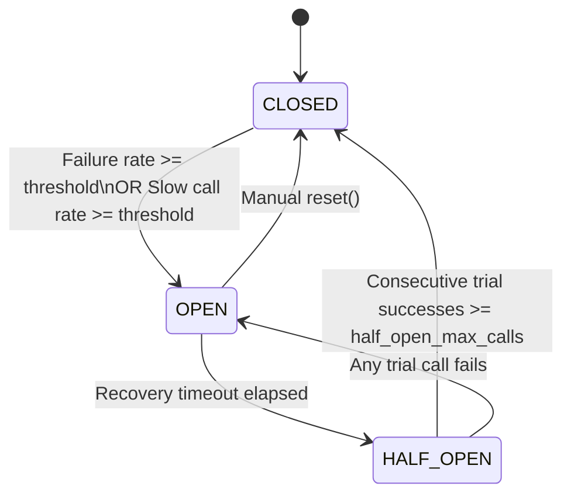
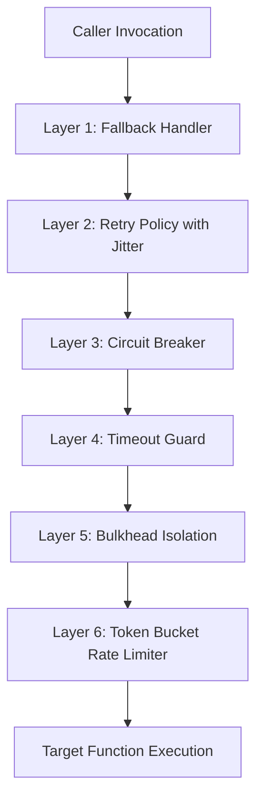

# FaultShield Architecture Guide

This document describes the architectural philosophy, internal state machines, mathematical models, and concurrency primitives behind **FaultShield**.

---

## 1. Architectural Philosophy

FaultShield is engineered around four core tenets:

1. **Zero External Dependencies**: Standard library only (`threading`, `time`, `functools`, `typing`, `collections`, `random`, `math`). No transitive bloat, binary build issues, or dependency version conflicts.
2. **Strict Thread Safety**: Every state transition, token deduction, ring buffer append, and counter increment is protected by fine-grained thread synchronization primitives (`threading.Lock`, `threading.RLock`, `threading.Condition`).
3. **Fluent Layered Composition**: Individual policies can be used standalone or composed together using `ResiliencePipeline`.
4. **Observable by Default**: Embedded telemetry records execution latencies (mean, p50, p90, p99), error distributions, circuit state durations, and rejection counts without performance degradation.

---

## 2. Circuit Breaker State Machine

The Circuit Breaker pattern prevents an application from repeatedly attempting an operation that is almost certain to fail, saving thread pools, network sockets, and downstream service bandwidth.

### State Definitions

- **CLOSED**:
  - All calls execute normally.
  - Results and latency durations are appended to a fixed-size ring buffer (`deque(maxlen=sliding_window_size)`).
  - Once the window contains at least `minimum_number_of_calls`, the failure rate and slow call rate are evaluated on every completion.
  - If either rate exceeds configured thresholds, the state transitions atomically to `OPEN`.

- **OPEN**:
  - All calls are fast-failed immediately by raising `CircuitOpenError` (or routed to `fallback` if configured).
  - The downstream function is never invoked.
  - An internal timer records the duration in OPEN state.

- **HALF_OPEN**:
  - Triggered automatically once `recovery_timeout` has elapsed.
  - Allows up to `half_open_max_calls` probationary trial calls through.
  - If all trial calls succeed, the circuit resets to `CLOSED` and the window is cleared.
  - If any trial call fails with an expected exception, the circuit trips back to `OPEN` immediately.

---

## 3. Backoff & Jitter Mathematics

When external services experience outages, thundering herds of retrying clients can prevent recovery. FaultShield provides four retry backoff algorithms:

### 3.1 Exponential Backoff (No Jitter)
$$\Delta t_k = \min(\text{max\_delay}, \text{initial\_delay} \times \text{backoff\_factor}^{k-1})$$

### 3.2 Full Jitter (Recommended for Distributed APIs)
Full jitter uniformly randomizes the delay between zero and the full exponential backoff bound, breaking up lockstep retries:
$$R_k = \min(\text{max\_delay}, \text{initial\_delay} \times \text{backoff\_factor}^{k-1})$$
$$\Delta t_k \sim \mathcal{U}(0, R_k)$$

### 3.3 Equal Jitter
Equal jitter keeps half the delay deterministic while randomizing the remaining half:
$$\Delta t_k = \frac{R_k}{2} + \mathcal{U}\left(0, \frac{R_k}{2}\right)$$

### 3.4 Decorrelated Jitter
Decorrelated jitter computes the delay based on the preceding sleep duration rather than attempt count, preventing synchronized waves:
$$\Delta t_k = \min(\text{max\_delay}, \mathcal{U}(\text{initial\_delay}, 3 \times \Delta t_{k-1}))$$

---

## 4. Token Bucket Rate Limiting

The Rate Limiter employs a continuous Token Bucket algorithm:

- Tokens replenish continuously based on elapsed monotonic clock delta:
$$\text{tokens}_{\text{current}} = \min\left(\text{capacity}, \text{tokens}_{\text{prev}} + \Delta t \times \text{rate}\right)$$
- If sufficient tokens exist, the requested count is atomically deducted.
- If tokens are insufficient, the caller either fast-fails with `RateLimitExceededError` (containing calculated `retry_after`) or sleeps until tokens replenish up to the specified `timeout`.

---

## 5. Bulkhead Concurrency Barrier

The Bulkhead isolates resources to prevent runaway downstream operations from consuming all execution threads:

- Tracks `active_calls` against `max_concurrent`.
- Provides an optional waiting queue up to `max_queued`.
- Uses a `threading.Condition` monitor pattern. If active slots and queue capacity are saturated, incoming callers are rejected immediately with `BulkheadFullError`.

---

## 6. Resilience Pipeline Composition Order

When wrapping an operation with `ResiliencePipeline`, layers are nested in the optimal architectural order:

### Execution Semantics:
1. **Fallback (Outer)**: Catches any final unhandled exception from the inner stack and substitutes a graceful fallback response.
2. **Retry**: Repeats the downstream stack when retryable exceptions occur.
3. **Circuit Breaker**: Fast-fails calls when the downstream service is unhealthy, avoiding retrying into dead endpoints.
4. **Timeout Guard**: Aborts any individual invocation that takes longer than the allotted limit.
5. **Bulkhead**: Limits concurrent executions of the underlying target.
6. **Rate Limiter (Inner)**: Shapes outgoing request rate right before dispatching the target function.
